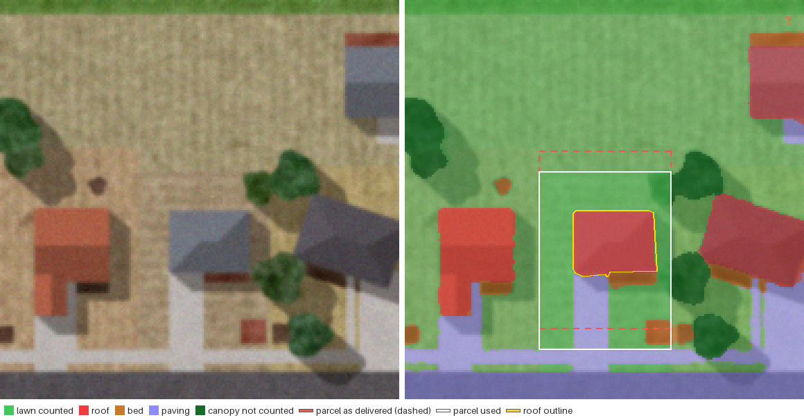

# Satellite property measurement

Lawn, bed, paving and roof measurements from satellite imagery for instant quotes, with a segmentation model fine-tuned on traced properties and a benchmark that scores everything in square feet. A quoting app sends a property; the API fetches the capture, the county parcel and any lidar roof pitch, runs a U-Net, and turns the class map into lawn area (including turf under trees and the mowed strip between sidewalk and curb), bed area, paved area, roof area with pitch, and roof perimeter, with a reason attached whenever a person should check the figure. Model releases go through a benchmark run and a release gate, and the corrections estimators make in the quoting screen choose the next properties to label.

This is a reference implementation of the architecture behind a measurement system I built for a mid-sized company that sells estimating software to landscaping, snow removal and exterior cleaning contractors. The production build is under NDA, so a few integrations are abstracted behind adapters: the satellite tile API, the county parcel feed and the lidar pitch source are tables the seed fills, and labeling happened in CVAT rather than in a generator. It runs on synthetic data, and every company, place, person, phone number and figure in it is made up.

[](https://github.com/AlexKurinets/satellite-property-measurement/actions/workflows/ci.yml)



`live-cs-0036`, a winter capture from the coastal-south market where every lawn is dormant, as `GET /v1/measurements/{id}/overlay.png` returns it. Inside this parcel the original model labels most of that tan turf as building, since it has only seen green lawns; the fine-tuned one counts it as lawn. The county parcel (dashed) arrived 2.57 m short of the sidewalk and was snapped to it (white), canopy surrounded by lawn is counted, and the roof outline (yellow) gives 852 sq ft of plan area, 950 sq ft at the lidar pitch of 5.9/12. Measured lawn is 2,502 sq ft against 2,551 sq ft of synthetic truth; roof 950 against 928.

## Architecture

```mermaid
flowchart LR
    Q["Quoting app"] -- "POST /v1/measurements" --> API["Measurement API<br/>(FastAPI)"]
    subgraph ADAPTERS["Adapters (tables here)"]
        IMG["Satellite capture<br/>zoom 19, frontage down"]
        PAR["County parcel<br/>as delivered"]
        PIT["Lidar roof pitch<br/>where covered"]
    end
    ADAPTERS --> API
    API --> M["U-Net<br/>6 classes, full resolution"]
    M --> PL["Pipeline v2<br/>snap parcel, frontage strip,<br/>canopy rule, whole roofs,<br/>pitch, simplified perimeter"]
    PL -- "figures + review reasons" --> Q
    PL --> PG[("Postgres<br/>measurements, corrections,<br/>models, benchmark runs")]
    Q -- "estimator corrections" --> PG
    PG -- "largest corrections<br/>per market" --> LQ["Label queue"]
    LQ --> LB["Traced labels"]
    LB --> FT["Fine-tune<br/>new head, lower LR on body,<br/>checkpoint by area error"]
    FT --> BM["Benchmark<br/>sq ft error per feature,<br/>market, season"]
    BM --> G{"Release gate"}
    G -- "promote" --> M
```



Compose runs three services: `db` (Postgres 16), `trainer` (a one-shot job that seeds the synthetic properties, trains the base model, fine-tunes it, runs the benchmark and the gate, promotes, and replays a month of quotes with simulated estimators) and `api`, which starts once the trainer has finished.

## What the benchmark shows

150 held-out properties, 50 per market, 25 of them winter captures with dormant lawns. Median absolute area error in percent (90th percentile in brackets):

| Run | Lawn | Roof (with pitch) | Paving | Beds | Roof perimeter |
|---|---|---|---|---|---|
| Traced masks through pipeline v1 (oracle) | 18.6 (36.2) | 13.7 (28.8) | 21.9 | 4.0 | 1.2 |
| Traced masks through pipeline v2 (oracle) | 1.2 (4.6) | 1.6 (5.7) | 2.9 | 3.0 | 1.6 |
| `lc-unet-1.0`, pipeline v1: what shipped before | 21.8 (92.6) | 13.7 (104.5) | 31.1 | 16.7 | 17.3 |
| `lc-unet-1.0`, pipeline v2: fix the pipeline, don't retrain | 1.6 (90.4) | 3.8 (90.3) | 11.7 | 15.3 | 3.3 |
| `prop-unet-2.0`, pipeline v2: fine-tuned | 1.3 (5.3) | 1.9 (11.0) | 6.5 | 7.4 | 2.5 |

The first row is the finding to start from: with perfect segmentation, the original measurement code still comes out 18.6% low on lawns and 13.7% low on roofs, so no fine-tune could have fixed that part. The fourth row shows what the pipeline fixes alone buy. The median looks almost as good as the fine-tuned model, but the 90th percentile doesn't, because the failures are concentrated. On the 25 dormant-lawn captures the base model's lawn error is 94.2% through pipeline v2 and 1.1% after fine-tuning. On mountain-west beds, mostly gravel the base model never saw, bed error drops from 86.5% to 8.7%. Replaying a month of quotes on the 90 live properties, the simulated estimators corrected 87 measurements under the old model and pipeline and 13 under the new ones.

These figures are from synthetic imagery, which is cleaner than real captures, so the fine-tuned errors here are lower than production's (about 6% on lawns and 5% on roofs on a traced 300-property benchmark). What carries over is the method and where the error comes from, not the absolute numbers.

## Design decisions

**Score in square feet, and find out what the model is responsible for first.** `src/propmeasure/evaluate.py` scores every (model, pipeline) pair on the traced benchmark split as percentage area error per feature: median absolute error, median signed error (a market-wide lean makes every quote in that market run high or low, so bias is gated separately), 90th percentile and the share within 10%, overall and by market and capture season. Mean IoU is logged but never decides anything. The oracle run (`propmeasure evaluate --oracle`) feeds the traced masks through a pipeline instead of model output, so whatever error is left belongs to the pipeline.

**Snap the parcel to the sidewalk, then add the strip crews mow.** County parcel polygons arrive offset from the imagery, here by up to 2.5 m front to back. `find_street` in `src/propmeasure/measure.py` walks up from the road through the strip and the sidewalk band in the predicted class map and moves the parcel so its front line sits on the back of the sidewalk; when there is no sidewalk the parcel is used as delivered and the measurement says so. The lawn between sidewalk and curb across the frontage is outside every parcel but gets mowed, so it is added as `frontage_lawn_sqft`.

**Canopy surrounded by lawn is lawn.** Turf under a tree is mowed and fertilised but invisible from above. A canopy component counts as `lawn_under_canopy_sqft` when at least half of a 1.5 m ring around it is lawn; a tree over a driveway or a bed does not. It is reported on its own line so an estimator can see how much of a lawn figure is inferred, and a lawn that is more than 35% canopy is flagged.

**Whole roofs by overlap, then pitch.** Clipping roofs at the parcel line cuts houses that sit close to it and can take a slice of the neighbour's. Pipeline v2 labels roof components and keeps the ones with at least half their area inside the snapped parcel, whole, and fills holes left by chimneys and skylights. Satellite imagery shows plan area; the roofing figure is surface area, plan area times sqrt(1 + (rise/12)^2), so a 6/12 roof is 11.8% larger than its footprint and a 12/12 roof 41% larger. Pitch comes from lidar where it covers the property (`pm.pitch_observations`); otherwise 6/12 is assumed and `needs_pitch_from_estimator` tells the quoting screen to ask.

**Perimeter on a simplified outline.** Counting the roof perimeter along pixel edges runs long by |cos a| + |sin a| on an edge at angle a to the grid, 28% at 20 degrees, and more on a ragged predicted edge. `geo.simplified_perimeter_px` traces the outline with marching squares and simplifies it (Douglas-Peucker, 0.9 px tolerance) before measuring.

**Fine-tune: keep the body, start a new head, train the body slower.** The base model (`lc-unet-1.0`) was trained on public land-cover classes; its `bare_soil` covers both mulch beds and dirt, and it has never seen a dormant lawn, a gravel bed or a low winter sun. `propmeasure finetune` keeps its encoder and decoder, replaces the class head (`model.swap_head`), and trains with two parameter groups, the head at 3e-3 and the pretrained layers at 0.3 of that, with warmup, cosine decay, cross-entropy plus Dice, 90 degree rotations, flips and colour jitter (`src/propmeasure/train.py`).

**Choose the checkpoint by area error, not IoU.** Every 200 steps the fine-tune measures the 60 validation properties through pipeline v2 and keeps the checkpoint with the lowest mean median error across lawn, bed, paving and roof plan area, logging mean IoU next to it. The model's `train_config` records both the selected step and the best-IoU step. In production they differed; in this run both were the last step.

**A U-Net, because boundaries are area.** At 30 cm a one-pixel boundary error on a 4,000 sq ft lawn is about 6% of its area, so the decoder returns to full resolution through skip connections rather than predicting at a quarter of the input and upsampling. Production used an ImageNet-pretrained ResNet-34 encoder; `src/propmeasure/model.py` keeps the same layout at widths that train on a CPU.

**A release gate per market.** `config/release_gate.yaml` holds the rules `registry.run_benchmark` applies to a candidate: lawn and roof median error under a ceiling, median signed error within 3%, better than production overall, and no market more than 2 points worse than production, because an average can improve while one market gets worse. `propmeasure promote` refuses a version without a passing gated run.

**Say when a figure needs a person.** A measurement carries review reasons instead of a silent number: no sidewalk to align the parcel, more than 35% of the lawn under canopy, mean model confidence inside the parcel under 0.85, or imagery more than 18 months old. On the benchmark 20.7% of the fine-tuned model's measurements carry at least one.

**Estimator corrections choose the next labels.** `POST /v1/measurements/{id}/corrections` stores the value an estimator typed with the value it replaced. `propmeasure label-queue` lists unlabelled properties with the largest corrections under the production model, taken in turn from each market so one market's problem can't fill the whole batch. A pitch the estimator types because the screen asked for one is an input, not a correction, so roofs with correct outlines don't go to the annotators.

## Synthetic properties

`src/propmeasure/synth.py` lays out each property in metres with the street along the bottom edge (production rotated every capture so the frontage faces down): the target parcel, two side neighbours and a rear neighbour, each with a house (gable or hip roof, sometimes an attached garage wing, 30% rotated by up to 20 degrees), driveway, walkway, foundation and island beds, a patio, trees and their shadows, and the road, the mowed strip and the sidewalk in front. It draws everything on a grid four times finer than the imagery and averages it down, so boundary pixels are mixtures the way real 30 cm pixels are; truth areas come from the fine grid, which stands in for tracing on sharper imagery. Each capture sits on the zoom-19 Web Mercator grid at its market's latitude (ground resolution 0.227 to 0.258 m), and its county parcel arrives shifted by up to 0.6 m sideways and 2.5 m front to back.

The two domains differ the way the production data did. The base domain is the public land-cover look the original model learned from: summer lawns, mulch beds, moderate shadows, and a `bare_soil` class that covers beds and dirt alike. The three client markets each carry the failure that mattered there: in `coastal-south` 45% of captures are winter imagery with dormant tan lawns, `mid-atlantic` has heavy canopy over lawns, and `mountain-west` has gravel beds and low winter sun with long shadows.

## Running it

```bash
cp .env.example .env    # optional: change host ports or training length
docker compose up -d --build
docker compose logs -f trainer    # 10 to 15 minutes: seed, train, fine-tune, benchmark, gate, live month
docker compose run --rm trainer propmeasure status
```

The trainer seeds 940 properties (400 base-domain, and in the client markets 240 to fine-tune on, 60 for checkpoint selection, 150 for the benchmark and 90 live ones without labels), trains `lc-unet-1.0` on the base domain and puts it in production with pipeline v1, scores it through both pipelines, fine-tunes `prop-unet-2.0`, runs the gated benchmark, promotes it, and replays a month of quotes on the live properties under each model, with a simulated estimator correcting any lawn or roof figure more than 10% off. `propmeasure status` then shows:

```
properties: base 400, live 90, test 150, train 240, val 60
models:
  lc-unet-1.0     retired     label set base    pipeline v1
  prop-unet-2.0   production  label set client  pipeline v2
benchmark (median abs error / bias, %):
  traced masks (oracle)  v1  lawn 18.6/-18.6  bed 4.0/-3.0  pavement 21.9/-4.9  roof 13.7/-13.7  roof_perimeter 1.2/+1.0
  traced masks (oracle)  v2  lawn 1.2/-0.3  bed 3.0/-1.8  pavement 2.9/+0.3  roof 1.6/-1.3  roof_perimeter 1.6/-1.6  flagged 20.0%
  lc-unet-1.0            v1  lawn 21.8/-21.8  bed 16.7/-7.9  pavement 31.1/+14.7  roof 13.7/-10.6  roof_perimeter 17.3/+17.3
  lc-unet-1.0            v2  lawn 1.6/-0.9  bed 15.3/-5.7  pavement 11.7/+3.5  roof 3.8/-0.7  roof_perimeter 3.3/-1.1  flagged 30.0%
  prop-unet-2.0          v2  lawn 1.3/-0.5  bed 7.4/-3.0  pavement 6.5/+2.9  roof 1.9/-1.4  roof_perimeter 2.5/-1.1  flagged 20.7%
estimator edits on live measurements:
  lc-unet-1.0     v1  87/90 corrected (96.7%), 0.0% flagged for review
  prop-unet-2.0   v2  13/90 corrected (14.4%), 21.1% flagged for review
```

These are the figures from the Compose stack on Linux. Training on another CPU or thread count can move them by a few tenths of a point.

API: http://localhost:8190/docs (the token for POST requests is `local-dev-token` unless `.env` changes it).

```bash
curl -s -X POST http://localhost:8190/v1/measurements -H "Authorization: Bearer local-dev-token" \
  -H "Content-Type: application/json" -d '{"property_id": "live-cs-0003"}'
curl -s http://localhost:8190/v1/measurements/<id>/overlay.png -o overlay.png
curl -s -X POST http://localhost:8190/v1/measurements/<id>/corrections -H "Authorization: Bearer local-dev-token" \
  -H "Content-Type: application/json" \
  -d '{"feature": "lawn_sqft", "corrected_value": 4150, "corrected_by": "estimator-demo", "note": "back fence line"}'
curl -s "http://localhost:8190/v1/label-queue?limit=6"
```

The same from the command line, plus the benchmark runs:

```bash
docker compose run --rm trainer propmeasure measure test-ma-0004 --overlay /tmp/test-ma-0004.png
docker compose run --rm trainer propmeasure evaluate --oracle --pipeline v1
docker compose run --rm trainer propmeasure evaluate --model prop-unet-2.0
docker compose run --rm trainer propmeasure label-queue --limit 6
docker compose run --rm trainer propmeasure promote lc-unet-1.0    # refused: no passing gated run
```

`docker compose down -v` removes everything. Re-running `docker compose up` on an existing volume skips every bootstrap step already done.

Without Docker: Python 3.11+, a Postgres 16 database in `DATABASE_URL`, `pip install torch --index-url https://download.pytorch.org/whl/cpu`, `pip install -e .`, then `propmeasure bootstrap` and `uvicorn propmeasure.api:app`.

## Tests

```bash
docker run -d --name pm-test -e POSTGRES_USER=pm -e POSTGRES_PASSWORD=pm -e POSTGRES_DB=pm_test -p 5513:5432 postgres:16
TEST_DATABASE_URL=postgresql://pm:pm@localhost:5513/pm_test pytest
```

36 tests. `test_geo.py` covers ground resolution against latitude, lon/lat to capture-pixel round trips, parcel rasterisation, the pitch factor, and staircase against simplified perimeters on rotated rectangles. `test_synth_and_measure.py` runs the pipelines on traced masks: the parcel snap recovers the delivered offset, v2 beats v1 on lawn and roof, roofs are taken whole without neighbours, the canopy rule counts canopy over lawn and not over paving, and a missing pitch defaults and asks. `test_model_and_eval.py` checks the head swap leaves the pretrained layers untouched, weights round-trip, a short run lowers the loss, and the gate blocks a market regression hidden by a better average and a bias outside 3%. `test_stack.py` runs against Postgres: seeding, the registry, promote refusing without a gated run and on a failed gate, promotion after a passing one, the API (401 without a token, 404, 422 on an unknown feature, overlay PNG, corrections) and the estimator loop feeding the label queue. CI runs ruff and the tests with a Postgres service, and a second job runs `scripts/smoke.sh`, which brings the Compose stack up and runs every command block in this README.

## Layout

```
src/propmeasure/
  synth.py        synthetic properties: imagery, label masks, parcels, measured truth
  geo.py          Web Mercator ground resolution, parcel rasterisation, pitch factor, perimeters
  model.py        U-Net, head swap, weight serialisation
  train.py        training loop, discriminative learning rates, checkpoint selection hook
  measure.py      pipelines v1 and v2: class map to square feet and review reasons
  evaluate.py     benchmark scoring per feature, market and season; the release gate
  registry.py     model registry, benchmark runs, promotion
  service.py      measurements, corrections, label queue, simulated estimators, status
  api.py          HTTP API
  overlay.py      side-by-side overlay PNG
  seed.py, db.py, schema.sql, cli.py
config/release_gate.yaml
scripts/smoke.sh  brings the stack up and runs every command block in this README
```

## What is deliberately left out

- The imagery, parcel and lidar sources. Production fetched zoom-19 tiles from a commercial satellite imagery API, parcel polygons from a county parcel feed and pitch from a lidar-derived surface model, and rotated each capture so the frontage faces down; here those are tables the seed fills with captures already in that orientation.
- CVAT. Production traced polygons there and rasterised them; here the generator writes the masks.
- The ImageNet-pretrained ResNet-34 encoder and GPU training. The base model here is a narrow U-Net trained from scratch on the base domain in about five minutes on four CPU cores.
- Shadow mode, where a candidate measures live requests next to production without its figures being shown.
- Lots larger than one capture (production tiled them with overlap), detached garages and sheds, building lean in off-nadir captures, and pools as a measured feature.
- Authentication beyond a static bearer token, and rate limiting.

## License

MIT, Alex Kurinets
